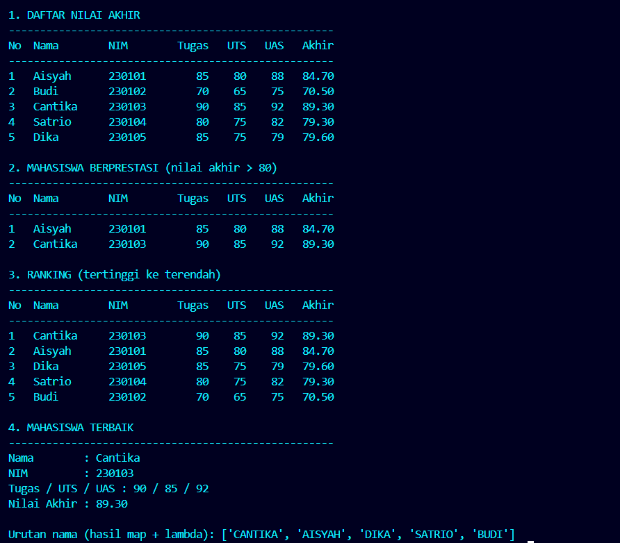

# Studi Kasus 1 - Analisis Nilai Mahasiswa

## Masalah yang Diselesaikan

Bagian akademik menerima data nilai mahasiswa berupa *list of dictionary*. Program ini:

1. Menghitung **nilai akhir** dengan bobot Tugas 30%, UTS 30%, UAS 40%.
2. Memfilter **mahasiswa berprestasi** (nilai akhir > 80) tanpa loop `for` bertingkat.
3. Membuat **ranking** dari nilai tertinggi ke terendah.
4. Mengumumkan **mahasiswa terbaik** beserta NIM dan rincian nilainya.

## Konsep Python yang Digunakan

| Konsep | Penerapan di program |
|--------|----------------------|
| List comprehension | Menghitung nilai akhir seluruh mahasiswa dan memfilter nilai > 80 |
| Lambda function | `key=lambda m: m["nilai_akhir"]` pada `sorted()`, dan `map()` untuk membuat daftar nama |
| Filtering & sorting | Filter dengan kondisi di comprehension; `sorted(..., reverse=True)` untuk ranking |
| Dict unpacking | `{**m, "nilai_akhir": ...}` menambah kunci tanpa mengubah data asli |
| Konstanta | `BOBOT` dan `BATAS_PRESTASI` agar tidak ada angka "ajaib" di kode |

## Cara Menjalankan

```bash
cd case-01-analisis-nilai
python main.py
```

## Bukti Eksekusi

