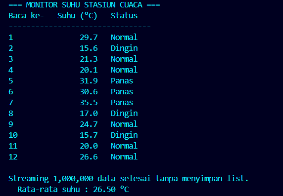

# Studi Kasus 2 - Streaming Data Sensor IoT Hemat Memori

## Masalah yang Diselesaikan

Stasiun cuaca mengirim ribuan bacaan suhu per jam. Memuat semuanya ke dalam satu list akan menguras memori. Program ini memakai **streaming bertahap**: data hanya dibuat dan diproses satu per satu saat diminta.

1. Generator `baca_sensor()` mensimulasikan suhu acak 15,0 sampai 38,0 °C.
2. Data dikonsumsi satu per satu dengan `next()`, tanpa menampung seluruh deret.
3. Setiap suhu langsung dikategorikan:
   - **Dingin**: < 20 °C
   - **Normal**: 20 sampai 30 °C
   - **Panas**: > 30 °C
4. Ditampilkan 12 pembacaan berturut-turut dalam tabel rapi.
5. Sebagai pembuktian, program memproses 1.000.000 data lewat streaming dan mengukur puncak memorinya.

## Konsep Python yang Digunakan

| Konsep | Penerapan di program |
|--------|----------------------|
| Generator function & `yield` | `baca_sensor()` berhenti sementara di tiap `yield` dan menyimpan state-nya |
| Iterator pattern | Generator adalah iterator; data diambil satu per satu lewat `next(sensor)` (protokol `__next__`) |
| Lazy evaluation | Nilai baru dibuat saat diminta, bukan di awal |
| Efisiensi memori | 1 juta data diproses tanpa list; puncak memori diukur dengan `tracemalloc` dan hanya ratusan byte |
| `random.seed(42)` | Output reproducible agar hasil konsisten (hapus untuk data acak murni) |

## Cara Menjalankan

```bash
cd case-02-iot-generator
python main.py
```

## Bukti Eksekusi

