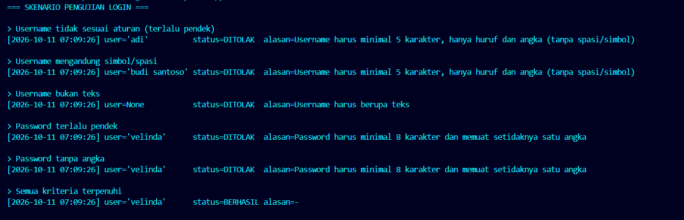

# Studi Kasus 3 - Sistem Keamanan Akun & Audit Log Login

## Masalah yang Diselesaikan

Verifikasi login harus ketat, dan setiap percobaan (berhasil maupun gagal) harus tercatat otomatis tanpa mengotori logika utama.

**Aturan validasi:**
- **Username**: minimal 5 karakter, hanya huruf dan angka (tanpa spasi atau simbol).
- **Password**: minimal 8 karakter dan memuat setidaknya satu angka (0-9).
- Input yang bukan teks (misalnya `None`) ditolak dengan alasan yang jelas.
- Pemeriksaan format memakai **RegEx**.

**Fitur:**
- Class `User` dengan `@property` untuk username dan password.
- Decorator `@audit_log` yang mencatat timestamp, nama pengguna, status (`BERHASIL` / `DITOLAK`), dan alasan penolakan.
- 6 skenario uji di `main()`: username tidak valid (pendek, bersimbol, bukan teks), password tidak valid (pendek dan tanpa angka), serta login sukses.

## Konsep Python yang Digunakan

| Konsep | Penerapan di program |
|--------|----------------------|
| RegEx (`re`) | `[A-Za-z0-9]{5,}` untuk username; `(?=.*[0-9]).{8,}` untuk password (lookahead memastikan ada angka 0-9). Memakai `fullmatch()` agar seluruh teks harus cocok |
| `@property` & setter | Validasi otomatis setiap atribut diubah; data disimpan di atribut privat `_username`; getter password sengaja melempar error |
| Decorator | `@audit_log(riwayat)` membungkus `login()` tanpa mengubah isinya |
| Closure | Fungsi `pembungkus` mengingat list `riwayat` dari fungsi luarnya |
| `functools.wraps` | Menjaga nama dan docstring fungsi asli |
| `try/except` | Menangkap `ValueError` lalu mencatat alasan penolakan |
| Validasi tipe | `isinstance(nilai, str)` di setter mencegah error tak terduga pada input non-teks |
| Hashing (tambahan) | Password disimpan sebagai SHA-256 + salt acak (`hashlib`, `secrets`), bukan teks asli |

## Cara Menjalankan

```bash
cd case-03-login-security
python main.py
```

## Bukti Eksekusi

